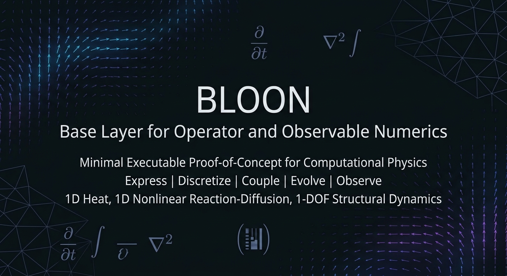
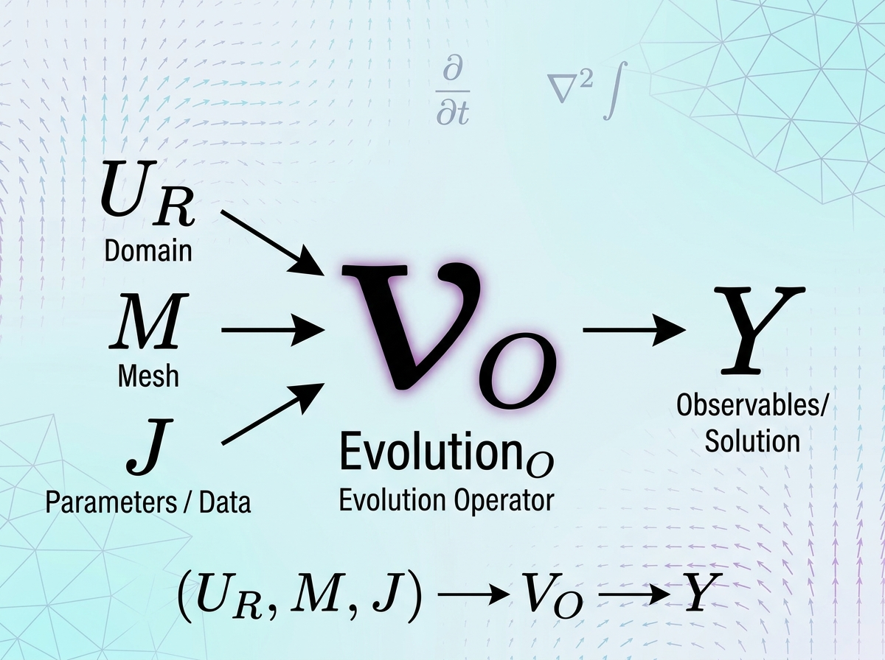
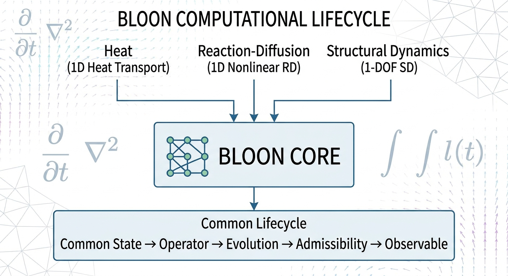
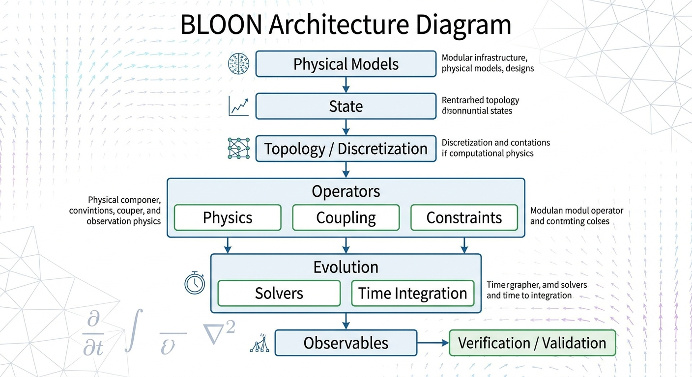

# BLOON v0.2

## Base Layer for Operator and Observable Numerics

**Prototype / Proof of Concept**

A minimal executable computational infrastructure for expressing, discretizing, coupling, evolving, and observing mathematical models of physical systems.



---

## Overview

BLOON is a computational infrastructure concept designed to provide a common computational representation for different mathematical models of evolving physical systems.

BLOON does not propose a unified physical theory, nor does it attempt to replace domain-specific numerical methods.

Instead, it provides a common computational structure around:

* State
* Topology and discretization
* Operators
* Constraints
* Evolution
* Solvers and time integration
* Observables
* Verification and validation

The central idea is:

> **Abstraction reduces software fragmentation; it does not eliminate mathematical complexity.**

BLOON is intended as a computational layer around mathematical models, rather than as a monolithic domain-specific solver.

---

## Computational Abstraction



BLOON separates the representation of a physical model from the computational mechanisms used to evolve its discrete state.

A simplified computational view is:

$$
\mathbf{U}
\;\xrightarrow{\mathcal{R},\,\mathcal{M},\,\mathcal{J}}\;
\text{Evolution}
\;\xrightarrow{\mathcal{O}}\;
\mathbf{Y}
$$

where:

* $\mathbf{U}$ is the computational state,
* $\mathcal{R}$ represents residual or spatial operators,
* $\mathcal{M}$ represents storage or capacity operators,
* $\mathcal{J}$ represents Jacobian information,
* $\mathcal{O}$ maps computational states to observables,
* $\mathbf{Y}$ represents quantities of interest.

The abstraction is intended to allow different physical models to share computational mechanisms while retaining their own mathematical structure.

---

## Computational Lifecycle



The current prototype demonstrates a common computational lifecycle across physically different models:

Physical Model
      ↓
    State
      ↓
Topology / Discretization
      ↓
   Operators
      ↓
   Evolution
      ↓
Admissibility
      ↓
 Observables
      ↓
Verification

The lifecycle separates the mathematical representation of a model
from the mechanisms used to discretize, evolve, observe, and verify
its computational state.

---

## Architecture



The BLOON infrastructure separates computational concerns into interacting layers:

                         BLOON
                           |
              +------------+------------+
              |                         |
            STATE                   TOPOLOGY
              |                         |
              +------------+------------+
                           |
                    DISCRETIZATION
                           |
                       OPERATORS
                           |
             +-------------+-------------+
             |             |             |
          PHYSICS       COUPLING     CONSTRAINTS
             |             |             |
             +-------------+-------------+
                           |
                    ADMISSIBILITY
                           |
                       EVOLUTION
                           |
                 +---------+---------+
                 |                   |
              SOLVERS          TIME INTEGRATION
                 |                   |
                 +---------+---------+
                           |
                      OBSERVABLES
                           |
                    VERIFICATION

The architecture is intentionally modular.

Physics-specific implementations provide mathematical operators and
models, while the computational infrastructure provides a common
execution lifecycle.

---

# Demonstrated Computational Models

BLOON v0.2 currently demonstrates the computational abstraction through
several numerical and geometric examples.

### 1. One-Dimensional Heat Transport

A one-dimensional heat equation is discretized using a finite-difference
spatial operator and evolved using implicit Backward Euler integration.

The example demonstrates state evolution, admissibility checking, and
observable extraction.

---

### 2. Nonlinear Reaction-Diffusion

A nonlinear reaction-diffusion model uses the same general
state/operator/evolution infrastructure.

The example includes positivity and admissibility verification.

---

### 3. One-Degree-of-Freedom Structural Dynamics

A one-degree-of-freedom structural oscillator is represented as a
first-order state-space system.

The numerical solution is compared against an analytical solution.

The observed reduction in discrete energy is associated with numerical
dissipation from the selected Backward Euler time integration. It should
not be interpreted as physical damping in the undamped oscillator.

---

### 4. Discrete Spherical Topology

BLOON includes a discrete spherical topology represented through a
triangular mesh.

The topology implementation provides the geometric and connectivity
structure required by the manifold diffusion example.

---

### 5. Diffusion on a Spherical Manifold

BLOON includes a prototype diffusion model on a two-dimensional
manifold embedded in three-dimensional space.

For the current spherical example, the discrete operator is constructed
using a cotangent/FEM-style formulation.

The current verification suite checks:

* Positive lumped mass matrix
* Approximate unit-sphere area
* Symmetry of the stiffness operator
* Positive semi-definite stiffness operator
* Constant-state preservation
* Mass conservation
* Non-increasing discrete Dirichlet energy

These checks validate specific properties of the current spherical
prototype. They should not be interpreted as a claim of a
general-purpose manifold solver.

---

# BLOON + BLOON_MACHINE

BLOON v0.2 introduces an optional integration boundary with
**BLOON_MACHINE v0.2**, a separate deterministic constraint/decision
kernel.

The two systems have deliberately different responsibilities:

                         BLOON
                           |
                  computation + facts
                           |
                           ▼
                  Integration Boundary
                           |
                    task / state data
                           |
                           ▼
                    BLOON_MACHINE
                           |
                    policy + decision
                           |
             +-------------+-------------+
             |             |             |
          ACCEPT          WARN         REJECT

The architectural invariant is:

> **BLOON = facts + computation**
> **BLOON_MACHINE = policy + decision**

BLOON_MACHINE does not replace the BLOON numerical infrastructure.
It operates as an external decision gate around computational tasks.

The integration boundary is exposed through the `integration.machine`
adapter.

---

## Responsibility Boundary

### BLOON provides

* Computational state
* Topology
* Discretization
* Operators
* Physics-specific models
* Evolution
* Observables
* Numerical verification

### BLOON_MACHINE provides

* External rules
* Policy evaluation
* Constraint validation
* Decision results
* `ACCEPT`
* `WARN`
* `REJECT`
* Fail-closed behavior

The adapter translates the relevant computational facts and task
information between the two systems.

It does not redefine the physical model or numerical solver.

---

## Decision Semantics

The current integration uses the following decision semantics:

**ACCEPT**

The request satisfies the evaluated machine policy and computation may
proceed.

**WARN**

A soft constraint is violated while no hard constraint blocks the
request. Computation may proceed while retaining the warning.

**REJECT**

A hard constraint is violated, or the machine cannot safely evaluate
the request. Computation is blocked.

This provides a deterministic, fail-closed boundary between computation
and external policy evaluation.

---

## External Policy Configuration

BLOON_MACHINE policies remain external to the BLOON numerical code.

Rules are provided through configuration rather than being manufactured
inside the BLOON integration layer.

Consequently, changing an external rule can change the resulting machine
decision without modifying the BLOON numerical implementation.

This separation keeps:

BLOON
    computation + facts

BLOON_MACHINE
    policy + decision

independent.

---

# Visualization and Animation

BLOON contains a separate visualization and animation layer designed
to communicate computational results and numerical algorithms.

The visualization architecture separates:

Simulation / Mathematical Result
              ↓
      Animation IR / API
              ↓
           Renderer

The rendering layer is intentionally separated from the numerical
computational infrastructure.

This allows numerical experiments and their visual representation to
evolve independently.

Current visualization work includes demonstrations of computational
geometry and numerical algorithms, including manifold visualization and
contact-mechanics-related concepts.

Visualization should therefore be understood as a communication and
demonstration layer, not as a dependency of the numerical core.

---

# Runnable Examples

The `examples/` directory contains standalone executable demonstrations.

### Heat Transport

```bash
python examples/run_heat.py
```

### Reaction-Diffusion

```bash
python examples/run_reaction.py
```

### Structural Dynamics

```bash
python examples/run_structural.py
```

### Discrete Topology

```bash
python examples/run_topology.py
```

### Spherical Manifold Diffusion

```bash
python examples/run_manifold_diffusion.py
```

### Manifold Visualization

```bash
python examples/visualize_manifold.py
```

### BLOON_MACHINE Integration

```bash
python examples/run_heat_with_machine.py
```

The integration demonstration evaluates a computational request through
BLOON_MACHINE before allowing the BLOON simulation to proceed.

A valid request produces:

Decision: ACCEPT
Gate passed. Proceeding with BLOON simulation...

An invalid request produces:

Decision: REJECT
Gate REJECTED. Simulation blocked.

---

# Verification

BLOON v0.2 includes automated verification covering numerical behavior,
architectural properties, and integration boundaries.

Current baseline:

python -m pytest tests -v

23 passed

The test suite currently covers:

* Heat-equation convergence
* Reaction-diffusion positivity and admissibility
* Structural dynamics against an analytical solution
* Spherical topology
* Manifold operator properties
* Constant-state preservation
* Conservation and decay behavior
* BLOON architectural agnosticism
* BLOON operation without BLOON_MACHINE
* BLOON_MACHINE ACCEPT path
* BLOON_MACHINE REJECT path
* External rule-change behavior
* Engine diagnostics
* Ethical fail-closed behavior
* Cross-working-directory integration
* Namespace-collision regression

---

## Cross-Working-Directory Verification

The BLOON_MACHINE integration is explicitly tested from multiple
working directories.

The same integration demonstration is verified from:

BLOON project root
BLOON_MACHINE project root
Unrelated working directory

The expected behavior remains deterministic:

Scenario A → ACCEPT
Scenario B → REJECT

The regression tests verify that the integration does not depend on the
current working directory or accidental Python module resolution.

---

# Design Principle

BLOON is based on a simple architectural proposition:

> **A common computational infrastructure can represent and evolve
> different physical models without requiring the infrastructure itself
> to become a universal physical theory.**

The abstraction is intended to reduce unnecessary software
fragmentation while preserving the mathematical structure specific to
each physical model.

The project favors small, composable computational mechanisms rather
than a single monolithic solver.

---

# What Changed in v0.2

BLOON v0.2 extends the original proof-of-concept with:

* Expanded numerical demonstrations
* Discrete spherical topology
* Spherical manifold diffusion
* Additional operator verification
* Expanded automated test coverage
* Visualization and animation infrastructure
* BLOON_MACHINE integration
* External policy/rule evaluation
* Deterministic ACCEPT/WARN/REJECT decision gating
* Cross-working-directory integration verification
* Namespace-collision regression protection
* Explicit separation between computational facts and external policy

The underlying architectural principle remains unchanged:

> **Provide a common computational structure without attempting to
> eliminate domain-specific mathematical complexity.**

---

# Scope and Non-Claims

BLOON currently does not claim to be:

* A universal physics solver
* A unified physical theory
* An industrial-scale multiphysics platform
* A production CFD package
* A production FEM package
* A replacement for established numerical methods
* A general-purpose manifold solver
* A production HPC framework

The current implementation is deliberately small and serves as an
executable proof-of-concept of the proposed computational abstraction.

---

# Future Development

The following are future development directions and are **not claims of
current implementation**:

* More advanced sparse linear algebra
* Nonlinear solver extensions
* Adaptive discretization and mesh refinement
* Broader multiphysics coupling
* GPU and HPC execution
* Additional numerical formulations
* Expanded domain-specific computational modules
* Further development of the BLOON_MACHINE integration boundary

Future architecture will be developed incrementally while preserving
the separation between computational infrastructure, domain-specific
physics, and external decision/policy mechanisms.

---

# Public Repository Philosophy

The public repository is intended to communicate the computational
concept through:

Theory
  ↓
Architecture
  ↓
Executable Examples
  ↓
Verification / Validation
  ↓
Observable Results

The repository is not intended to expose every internal implementation
detail of the computational infrastructure.

The distinction between public computational artifacts and private
implementation machinery is intentional.

---

# Status

**BLOON v0.2 — Prototype / Proof of Concept**

BLOON currently demonstrates a generalized computational lifecycle
across multiple numerical and geometric models, together with an
optional external decision boundary through BLOON_MACHINE.

The project is intended to evolve incrementally from this foundation.

---

# License

License information will be added as the project matures.
